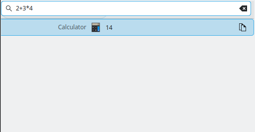

# SearchPillKDEWidget
Search Pill that familiar to windows 11

## Screenshots

The pill as it sits on the panel:


On hover the pill turns white and the magnifier fades to the blue-to-green gradient:


The search popup (results list and preview card):



These were captured in a `plasmawindowed` test window on Plasma 6.4.5, not on a live panel.

The widget package lives in [`search-pill/`](search-pill/). See [`search-pill/README.md`](search-pill/README.md) for details.

## Install

Requires KDE Plasma 6.

```bash
cd search-pill
./install.sh
```
